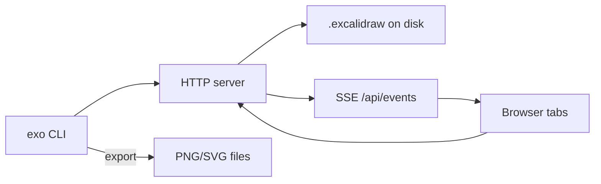

# Agents: enhancing exo

This file is for agents that change **exo** itself (the package under `exo/`).
For *using* exo to draw diagrams in other work, see `exo --help` and the
operator playbook in nix-darwin (`~/.ai/usecase/diagram.md` when installed).

## What exo is

A local, mo-style Excalidraw editor:

- CLI daemon opens `.excalidraw` JSON in the browser and saves back to disk
- One server = one **workspace folder** (sidebar stays inside that folder)
- Headless `exo export` writes PNG/SVG with **no browser / Playwright**
- Multi-tab safety: file **revisions**; stale saves get HTTP 409 and reload

Package name: `@yoshixi/exo`. Preferred install for this machine: nix package
that builds from this GitHub repo (`yoshixi/nix` → `pkgs/exo.nix`).

## Layout

| Path | Role |
| --- | --- |
| `src/` | Node CLI + HTTP server (TypeScript → `dist/`) |
| `web/` | React + `@excalidraw/excalidraw` UI (Vite → `dist/client/`) |
| `bin/exo.mjs` | Published bin entry (loads `dist/cli.js`) |
| `src/help.ts` | Text for `exo -h` / `--help` (keep agent-discoverable) |
| `src/export.ts` | Headless PNG/SVG via `@moona3k/excalidraw-export` |
| `test/e2e.mjs` | Playwright e2e (optional; not required for export) |

## Commands

Run from `exo/`:

```bash
pnpm install
pnpm build          # web + cli (clears dist/)
pnpm typecheck
pnpm test           # build:test + node:test (needs dist/client → run build first in CI)
pnpm test:e2e       # Playwright; only when changing real browser UX
```

Node **≥ 24**. Package manager: **pnpm** (see `packageManager` in `package.json`).

## Architecture (do not break casually)



- **Workspace scoping:** paths outside the server cwd are rejected.
- **Revisions:** `GET /api/files/:id` returns `revision`. `PUT` must send matching
  `baseRevision` or receive `409 conflict`. Successful PUT bumps revision and
  **broadcasts** `file-changed` (so other tabs reload). Do not reintroduce
  “suppress all watchers on save” without still announcing to other clients.
- **Export:** Node-only. Agents check drawings by exporting PNG then using vision —
  not by driving Chromium. Prefer extending `export.ts` / `exo export` over e2e.
- **Save thrashing:** Excalidraw `onChange` fires on selection/pan/zoom. Only PUT
  when `persistFingerprint` of durable fields changes; remote updates should use
  `updateScene` (not a full remount) so the canvas does not flash.
- **Reload loops:** After apply/load, adopt Excalidraw’s normalized fingerprint
  once (no PUT). File watchers must not re-announce when disk bytes match the
  last write — that was causing repeated `GET /api/files/:id` and canvas refresh.
- **Help:** CLI discovery for agents is `exo --help`. If you add commands, flags,
  or HTTP APIs agents need, update `src/help.ts` **and** its tests in
  `src/help.test.ts` / `src/cli.export.test.ts`.

## Tests

- Style: observable behavior (t-wada / Unit Testing principles) — literal
  expectations, one clear outcome per case, no mocks of our own modules.
- Prefer unit + `server.integration.test.ts` over Playwright for server/CLI.
- When changing save/SSE/export, add a regression test that would have failed
  before the fix (stale revision, announce-on-PUT, PNG magic bytes, etc.).

## Changing the public surface

If you change any of these, update the matching docs in the same PR:

1. CLI flags / subcommands → `src/help.ts` + README Usage
2. HTTP API → `src/help.ts` (HTTP section) + README if user-facing
3. Export behavior → README “Headless export” + help agent workflow
4. Package version for a release → `package.json` `version` (nix pin bumps
   separately in `yoshixi/nix`)

## Out of scope / caution

- Do not require a headless browser for PNG/SVG export.
- Do not drop workspace path checks.
- Do not publish secrets; `NPM_TOKEN` is only for the optional tag release
  workflow. Shipping via nix from this repo is enough for local use.
- Leave accidental scratch drawings (e.g. a lone `exo/s`) untracked.
